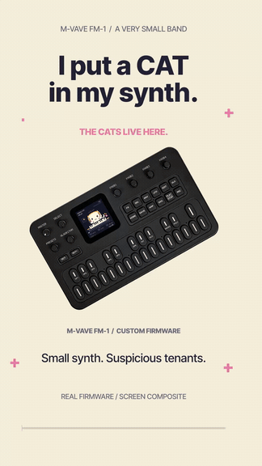
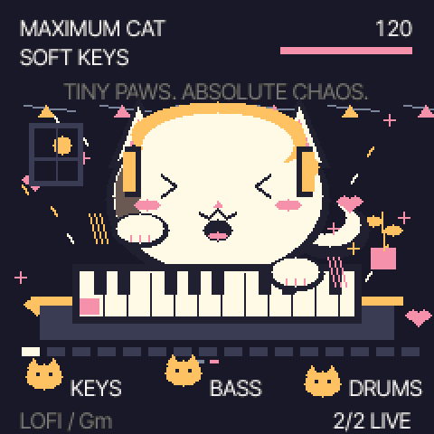
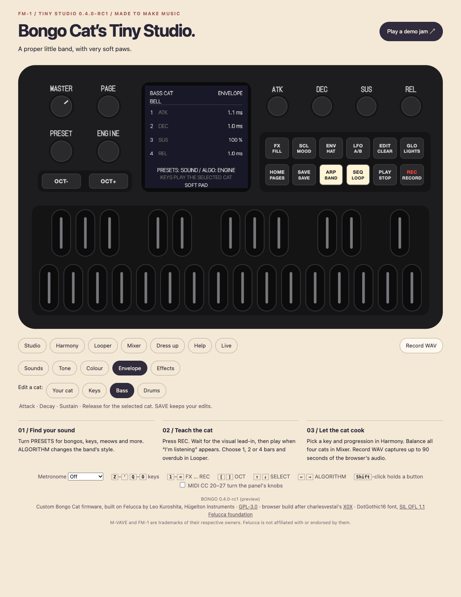
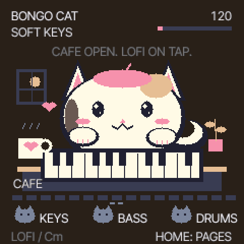
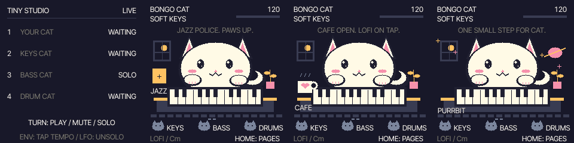

<div align="center">

# Bongo Cat’s Tiny Studio 🐾

**by [Impossible Knot](https://github.com/ImpossibleKnot)**

### Four cats. Thirteen sound engines. Absolutely no rent contributions.

**A playable little band for the M-VAVE FM-1.**

<a href="https://github.com/ImpossibleKnot/bongo-cat-studio/releases/download/v0.4.0-rc1/Tiny-Studio-Short.mp4">

</a>

[**▶ Full 32-second Short — with sound (MP4)**](https://github.com/ImpossibleKnot/bongo-cat-studio/releases/download/v0.4.0-rc1/Tiny-Studio-Short.mp4)

*Four seconds of responsible product demonstration. Then the cats take over.*

Your synthesizer has hired a cat. The cat has hired three more cats.<br>
Somehow, this is now a recording studio.

[**Download 0.4.0-rc1**](https://github.com/ImpossibleKnot/bongo-cat-studio/releases/tag/v0.4.0-rc1) · [**Install**](INSTALL.txt) · [**Controls**](BONGO-STUDIO.txt) · [**Build it**](BUILDING.md)

`FM-1 firmware` · `4 parts` · `13 engines` · `GPL-3.0-only` · `release candidate`

<sub>The Short uses actual firmware animation and audio. Its FM-1 opening is a screen composite using a M-VAVE product photo. [Media credits](docs/media/SHORT-CREDITS.md).</sub>

</div>

## Tiny paws. Actual music.

Tiny Studio turns the FM-1 into a small, expressive instrument with a cat at the keys, a generated backing band, and a looper for your own melodies. Built on [Felucca 1.6.1](https://github.com/hugelton/Felucca), it keeps serious sound editing close to the surface and puts a beret on the rest.

| Employee | Job description |
| --- | --- |
| **Your Cat** | Plays your melody. Records 1, 2 or 4 bars. Occasionally screams in tune. |
| **Keys Cat** | Follows the key and chord progression with smooth voice leading. Has strong opinions about jazz. |
| **Bass Cat** | Sustained, warm bass with a gentle dip under the kick. Finally audible at the staff meeting. |
| **Drum Cat** | Keeps time, adds energy and handles fills. Paid entirely in cardboard boxes. |

Each part can use any of the **13 synthesis engines**: analog, phase, lo-fi, samples, voice, trio, wheel, granular, physical modelling, drums, noise, FM6 and slice. Start with eight friendly lead sounds—bongos, soft keys, meow, chiptune, marimba, drum kit, bass and space bell—then edit as deeply as you like.

- **Make a song:** key and scale assistance, four progressions, swing, band energy and room reverb.
- **Catch a melody:** visual count-in, replace or overdub, quantized or as-played timing, and phrase undo.
- **Shape every part:** engine, preset, eight sound controls, ADSR, drive, chorus, delay and reverb.
- **Perform:** smooth mute/solo per cat and tap tempo that respects external MIDI clock.
- **Pawdo:** independent sound A/B on every part. For when the previous sound was better and we both know it.
- **Remember it:** SAVE and CRC-checked autosave retain your jam, sounds, mix and very important hat choices.
- **Keep it cosy:** three coats, six hat choices, four rooms and CALM mode. Metronome starts off.

The lead is the recordable phrase; keys, bass and drums are generated accompaniment. See the [full controls](BONGO-STUDIO.txt) for exactly what each page does.

## The legally required Maximum Cat section

<div align="center">


**Hold FX. The cat has received funding.**
</div>

Drum fills, big paws, flying hearts, confetti and a hardware light chase. Release FX to return to your page. CALM keeps the celebration still. There is no additional subscription tier above Maximum Cat.

## Download & install

**Current version: [0.4.0-rc1](https://github.com/ImpossibleKnot/bongo-cat-studio/releases/tag/v0.4.0-rc1), a public release candidate.**

| Download | What you get |
| --- | --- |
| [**Complete release ZIP — start here**](https://github.com/ImpossibleKnot/bongo-cat-studio/releases/download/v0.4.0-rc1/bongo-cat-studio-0.4.0-rc1.zip) | Firmware, complete corresponding source, backup/restore tools, installer, compiled browser preview, licences, checksums and test evidence. |
| [Firmware `.fwsc`](https://github.com/ImpossibleKnot/bongo-cat-studio/releases/download/v0.4.0-rc1/bongo-cat-studio-0.4.0-rc1.fwsc) | Just the installable package. Keep the accompanying source and licence bundle. |
| [Complete source `.tar.gz`](https://github.com/ImpossibleKnot/bongo-cat-studio/releases/download/v0.4.0-rc1/bongo-cat-studio-0.4.0-rc1-source.tar.gz) | Exact source snapshot for this release, including the engines. |
| [SHA-256 checksums](https://github.com/ImpossibleKnot/bongo-cat-studio/releases/download/v0.4.0-rc1/SHA256SUMS) | Checksums for the three downloads above. |

Read [INSTALL.txt](INSTALL.txt) before flashing. It walks through a verified backup, the normal Felucca updater and restoring an existing Bongo jam. The tested hardware upgrade is **Tiny Studio 0.3.0 → 0.4.0-rc1 on one FM-1**. Other starting firmwares need their own documented migration route; a Felucca backup is for returning to Felucca, not a Bongo jam import.

The package identity is `FM-1_980`; USB MIDI and audio still appear as **Felucca**. Keep your pre-update backup and previous working firmware. The normal Felucca update loader and recovery path remain in place.

## First jam in approximately one cat minute

1. Pick **soft keys**, **marimba** or **space bell** with PRESETS on Studio.
2. On **Harmony**, choose a key, major/minor, **COZY** and **IN KEY**.
3. On **Looper**, choose **2 bars**, **REPLACE** and **QUANTIZED**. Leave click off if you like.
4. Press **REC** while stopped. Watch the lead-in dots, then play when **I’M LISTENING** appears.
5. Your phrase starts looping. Try **OVERDUB**, balance the band on **Mixer**, then press **SAVE**.
6. Hold **FX** when your artistic vision requires a concerning number of hearts.

HOME or SELECT cycles pages. The four knobs follow the labels on the screen. MASTER always controls output volume.

| Page | Four knobs / useful buttons |
| --- | --- |
| Studio | Tempo · swing · energy · room |
| Harmony | Key · major/minor · progression · key assist |
| Looper | Length · replace/overdub · timing · metronome |
| Mixer | Your Cat · keys · bass · drums levels |
| Dress up | Coat · hat · room colour · calm/lively |
| Help | Metronome on knob 1 |
| Sounds | Part · engine · preset · level |
| Tone / Colour | Eight engine controls, with labels that follow the sound |
| Envelope | Attack · decay · sustain · release |
| Effects | Drive · chorus · delay · reverb |
| Live | PLAY/MUTE/SOLO for each cat; ENV taps tempo, LFO clears solo |

**Sound editing:** on Sounds through Effects, the keyboard auditions the selected part, ALGORITHM changes its engine, PRESETS changes its preset, and LFO swaps its sound A/B. On the original six pages, ALGORITHM loads a whole band style—including its backing sounds. Use the editor to keep your custom band intact.

## No FM-1? Borrow the browser cats

The release ZIP includes a compiled preview running the **same C audio engine, sequencer and renderer as WebAssembly**. From the unpacked release folder:

```sh
python3 -m http.server 8766 --bind 127.0.0.1 --directory preview
```

Open **http://127.0.0.1:8766/** in Chrome or Edge and click **Switch on**. Play the panel, audition the demo, edit sounds, and use **Record WAV** to export up to 90 seconds of stereo audio. The browser has its own saved state, separate from your physical FM-1.



*The bass cat would like 100% sustain and a heated blanket.*

The standalone cat GIFs are captures of the real firmware renderer using a fresh demo state; the screenshot shows the browser preview. The Short’s hardware opening combines the same renderer with a credited product photo, as labelled in the video.

## There are secrets in the keyboard

<div align="center">


*The café is open. The barista is six pixels tall and has tenure.*
</div>

<details>
<summary><strong>Open the forbidden sheet music 🐾</strong></summary>

Play these one note at a time on a melodic lead, with less than 1.8 seconds between notes. Use FREE key assist for the literal notes. Transposing the whole phrase works too.

| Phrase | Consequence |
| --- | --- |
| **D E F G E C D** | **Jazz Police.** Paws up. Your chord extensions are under investigation. |
| **C A F E** | **Cat Café.** A heart mug and tiny steam. No oat milk surcharge. |
| **A C E A E** | **Purrbit.** One small step for cat. One giant unpaid studio invoice. |

Stay on Studio to see the five-second scene. The rewards are visual; your notes, sounds and recording remain yours. CALM freezes the extra motion.



</details>

## Release candidate, with receipts

This build has passed six native ASan/UBSan suites, editor checks across all **4 parts × 13 engines**, recording and save/cold-boot regressions, 2,000 mixed live gestures, browser WASM/AudioWorklet checks, and exact-package update simulations.

On the tested FM-1, a **60-second stereo USB capture** had **zero clipped samples, zero new audio deadline misses and zero voices shed**; CPU was **38% at the sampled moment**. The existing jam and all 13 backup objects matched after the upgrade. See [verification evidence](docs/verification/VERIFICATION.json) and [test logs](docs/verification/test-logs).

The practical limits: one physical device, no manual power-cycle test or human check of every physical control, no long hardware soak, and no guarantee for every heavy-engine combination. USB audio excludes the metronome; click-off was checked separately through menu readback and the simulated DAC path. This is a release candidate, with shared CPU and voice limits. Please [report reproducible bugs here](https://github.com/ImpossibleKnot/bongo-cat-studio/issues).

## Build, tinker, contribute

```sh
git clone https://github.com/ImpossibleKnot/bongo-cat-studio.git
cd bongo-cat-studio
```

The engine sources are included in this repository. Follow [BUILDING.md](BUILDING.md) for the JieLi toolchain, SDK, firmware build, browser build and tests. The cat layer lives in `firmware/src/bongo_{state,audio,ui,storage}.*`; [CONTRIBUTING.md](CONTRIBUTING.md) explains the rest.

The release source archive is the exact build snapshot. This repository also includes the public README, media capture tools and release documentation added for publication. [Provenance](docs/PROVENANCE.md) records the upstream commits and package checksums.

## Standing on the shoulders of extremely good synths

Tiny Studio is an independent, AI-assisted custom build of **[Felucca](https://github.com/hugelton/Felucca)** by **Leo Kuroshita / [Hügelton Instruments](https://hugelton.com)** and its contributors. Their synthesizer, DSP, hardware work and tools make this possible. The browser build also follows work from [X0X](https://github.com/charlesvestal/fm1-x0x). Full attribution: [CREDITS.md](CREDITS.md).

The firmware is **[GPL-3.0-only](LICENSE)**. Bundled engines, fonts, samples and ported DSP retain their own licences: [LICENSING.md](LICENSING.md), [LICENSES/](LICENSES/). The cat drawings are original procedural artwork; the meow is synthesized. No downloaded meme sprites or song recordings are bundled.

M-VAVE and FM-1 belong to their respective owners. This project is not affiliated with or endorsed by M-VAVE or Hügelton Instruments.

<div align="center">

**Please give the cats a star. They have confused it with a MIDI note.** ⭐

</div>
